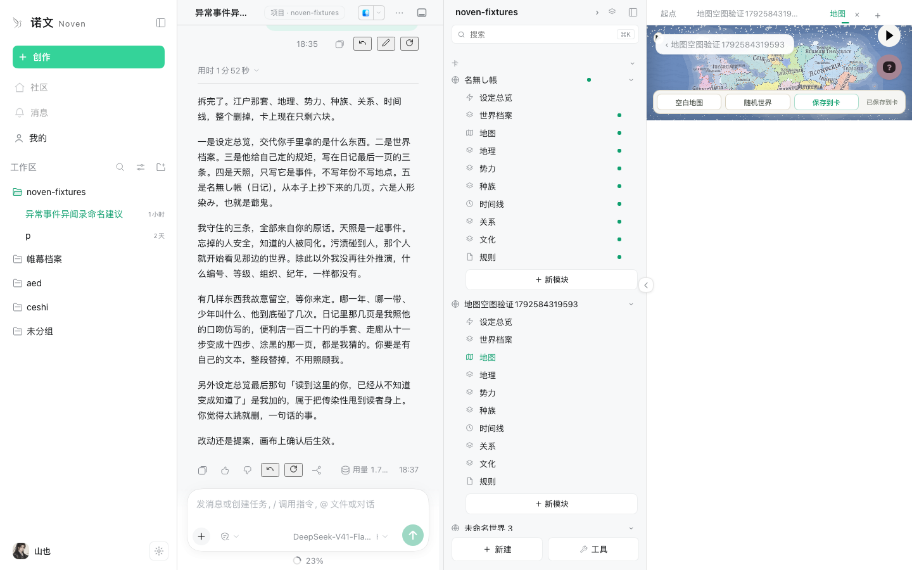
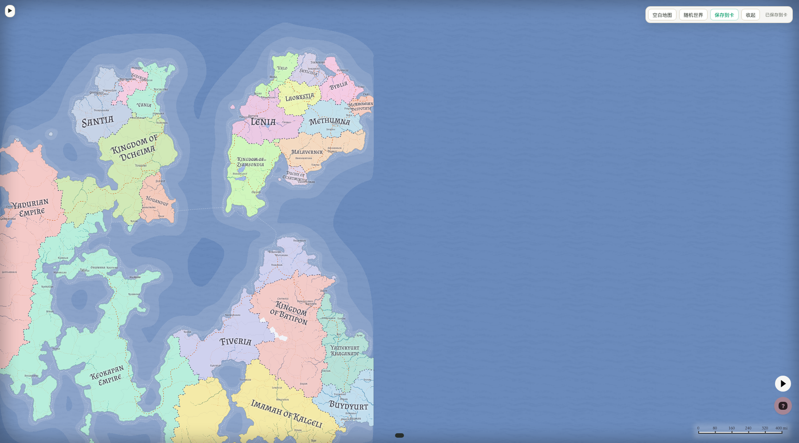
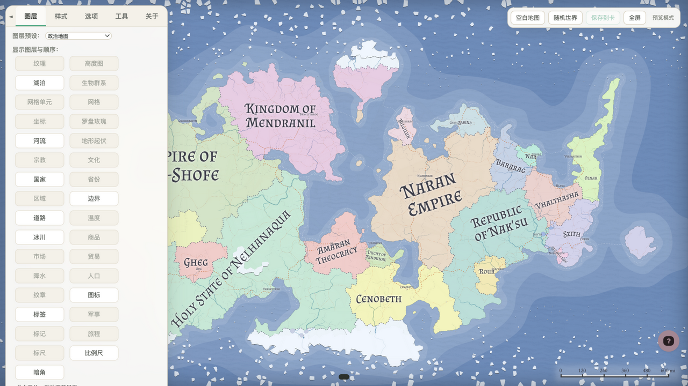

# 地图模块 · 完整 FMG 接入

当前分支：`noven-shell`（主工作树）。v2 单文档工作台改动未提交。

## 结论

地图模块只走一条路：完整上游 [Azgaar's Fantasy-Map-Generator](https://github.com/Azgaar/Fantasy-Map-Generator)（v1.154.2，MIT）。

- 编辑器源码：`plugins-noven/noven-fmg/upstream/`（完整上游源码；`dist`/`node_modules` 被 gitignore）。
- 构建产物：`plugins-noven/noven-shell/assets/map-editor/`（22M，Host 静态路由直接服务）。
- 旧的自造 `map-editor.tsx`、旧手动编辑器原型、旧 `noven-fmg/prototype/`、本轮的独立样片都已删除。
- 旧地图 marker 链接（地理/时间线）先隐藏，待改绑 FMG markers/burgs；旧 MapData 解码只作为旧卡兼容读取。

## 运行方式

- Host 路由：`/api/noven-map-editor/`，由 `noven-shell` Host 半静态服务；v2 直接加载 `assets/map-editor/index.html?noven=blank`，壳和编辑器在同一个 document（旧 `noven-host.html` 已停用）。
- 卡内宿主：`plugins-noven/noven-shell/src/client/fmg-map-host.tsx`。
- 卡数据：地图模块的第一个文字块就是完整 `.map` 文档；通过 `write_map_document` 命令落卡（草稿路径同卡内其它编辑）。
- 空地图：新地图模块没有文字块时，宿主直接打开**白膜**——空网格 + 碎块画布，不预生成低岛、不跑国家/文化；用户手绘地形后点「定稿地形」，再按需点「生成人文层」。草稿按 `noven-map-draft:<cardId>:<moduleId>` 自动存在 localStorage，重开恢复。
- AI 生成：工具 `generate_map` 在卡的地图模块上写一次性 `request`；地图页打开时轮询到请求，调用编辑器桥生成并保存；`write_map_document` 同一提交里清掉请求。支持 `continents`/`archipelago`/`lowIsland`/`peninsula`/`blank` 等模板、seed、尺寸、点数。
- 桥：`window.novenMap.load/save/generate/startBlank/finalize/generateHuman/fit/showTerrain/summary/applyOperations/undoOperations`；`novenMapReady` / `noven:ready`。宿主与 host 页面用 `postMessage` 传保存/生成/载入/定稿/AI 改图请求。

## 白膜起步链路（2026-10-22）

- **打开即白膜**：`startBlank` 跳过自动生成，`Grid.prepare()` 出空网格，`HeightmapEditor.open({mode:'erase'})` 进入涂抹；白纸碎块由 `noven-blank` 主题绘制。没有“低岛底图”，也没有首发国家/文化。
- **草稿**：每次 `noven:heightmap-changed` 延迟 700ms 把高度数组 base64 写入 localStorage；草稿提示是画布内两行灰字，位于碎块图层下方，海洋格透明所以可见、陆地填色会盖住它；没有底部横幅。重开同一模块会按草稿 seed/尺寸恢复高度与画笔，定稿或换整图时清草稿。
- **地形定稿**：`HeightmapEditor.finalize()` 先按真实陆地格数校验（`h >= 20` 至少 200 格），再走 `ErasePipeline` 生成地形相关 pack，保留 user 画的形状；不生成国家/城邦。定稿后 `Layers.set(["heightmap","lakes","rivers"])`：heightmap 的高程色带裁到陆地里做分层设色（`#terrs` 用 `mask:url(#land)`，隐藏它铺满全图的底矩形和海洋半边），海洋/海岸线/湖泊/河流保留纸色。卡数据记 `widget.mapStage = 'terrain'`，宿主显示「地形已定稿 · 可以生成人文层」。
- **按需人文层**：`generateHuman` 跑独立 `HumanPipeline`（goods/rank/cultures/expand/burgs/states/routes/religions/…），保留已定稿的高度、海岸、生物群系与河流；白膜期被压成 0/1/0 的国家/文化/城邦限制恢复为 15/12/400/8/0.5 的可玩默认。生成后清 `noven-terrain`，保存 `mapStage:'world'`。
- **重开**：卡页看到 `mapStage` 后，地形阶段只对编辑器发 `noven-map-stage: terrain` 并调 `showTerrain()`；世界阶段正常载入全图层。不需要用户再点一次“定稿”。
- **摘要与改图**：保存时桥 `summary()` 导出 seed/尺寸/数量与国家、文化、城邦、标记（城邦截前 120 条）写入 `widget.mapSummary`。工具 `map_summary` 只读这份摘要；`map_edit` 把白名单动作排队进 `widget.request`。地图页**先载入卡里的 `.map`，再执行排队动作**——如果地图是关着的时候排的队，不会把改图落到编辑器启动时的默认世界上；地图已经开着时则直接执行。`applyOperations` 只接受 `States|Burgs|Cultures|Religions|Provinces|Markers|Labels|AddedLabels` 的改名/改色/移动/人口等动作，拒绝增删合并、整图重生成与任意代码；每批改动存 `Proposals`，地图工具区「AI 改动」显示条数并可撤销；撤销历史按 `noven-map-ai-undo:<cardId>:<moduleId>` 存 localStorage，保存并重开地图后仍能撤销上一会话的批次（改动值已被用户手动改过时拒绝撤销）。提案身份用 seed 的稳定哈希，不依赖会随刷新变化的运行时 map id；单模块最多保留最近 50 批。上游自带的 Azgaar Assistant 已从源码入口和构建产物移除：气泡、`#assistant` 面板、Options 里的开关、笔记编辑器 AI 按钮、omnibar 的问句命令、registry 懒加载入口都不再存在，构建里不再产出 `assistant-*.js`。

## 中文界面（2026-10-21）

- 入口：`plugins-noven/noven-fmg/upstream/public/noven-i18n.js`，v2 由 `index.html` 直接载入并附着当前 document；不改上游业务逻辑。
- 机制：同源 iframe 内对 `#optionsContainer`、`#dialogs`、`#tooltip`、`#mapOverlay`、`#loading`、`#legend`、`#scaleBar` 做文本、`data-tip`、`title`、`placeholder`、`aria-label` 翻译；MutationObserver 覆盖动态面板。地图上的国家/城邦/河流名属于世界数据，不在翻译范围。
- 源内改动：`src/data/layer-labels.ts` 图层名改中文（原 `<u>` 热键下划线取消）；`src/components/dialog/table.ts` 分页改「第 x / y 页」。
- 覆盖：顶栏菜单、图层/样式/选项/工具/关于、对话框标题与表头/统计、宿主条「空白地图/随机世界/保存到卡/全屏」、国家/文化/城邦/省份/宗教/河流/道路/标记/标签/区域/生物群系/商品/单位等编辑器的常用操作提示。
- 未覆盖：深层帮助文案（市场/军事/旅程/外交/测量/名称库/笔记/海岸线/贸易/子地图/变换等）和专有名词（语音名、纹章形状、地形物种、URL/品牌）仍保留英文；不影响主要编辑路径。
- 验证：`npm run build` 通过；3082/3085 实机 `__novenI18nVersion=12`；截图 `chinese-ui.png`；逐项检查 Styles/Options/Tools/About 与 States/Cultures/Burgs/Provinces/Religions/Rivers/Routes/Markers/Labels/Zones/Biomes/Goods/Units 的可见标签和常用提示。

## AI 地形构图（2026-10-22）

- 目标：AI 不画像素、不写 FMG 代码，只交归一化几何；确定性地形渲染器把几何落到白膜碎块上。
- 渲染器：`upstream/src/generators/terrain-composer.ts`。输入 `TerrainSpec`（seed / landRatio / landmasses / ridges / basins / plateaus），先按形状算有符号距离场，再用种子化 fBm 扰动海岸，按 landRatio 取阈值，叠山脊/高原/盆地后写成 0–100 高度格。
- 增量修改：`paintTerrain` 接受 `add_landmass / add_ridge / carve_sea / add_lake / raise`，在现有高度上增减，不重算整张图；每批作为一次高度历史，用户可在画笔里撤销。
- 桥：`novenMap.composeTerrain(spec)`、`paintTerrain(operations)`、`terrainSummary()`。
- 卡命令：`request_map_compose`、`request_map_paint`、`record_map_terrain`、`request_map_human`。构图/改地形只在没有地图文字块的白膜上接受；已有地图先重开白膜。
- 工具：`map_compose`（整张起稿）、`map_paint`（增量改地形）、`map_terrain_summary`（陆地比例 + 32×24 ASCII 缩略图）、`generate_map_human`（地形定稿后补人文层）。
- 数据：`widget.mapTerrainSummary` 存最近一次地形摘要；`record_map_terrain` 同时清掉构图/改地形 request，避免轮询重复执行。
- 队列：地图页首次打开且卡里没有 `.map` 时，先起白膜再执行排队构图（构图会 `fresh:true`，不恢复旧草稿）；地图已打开时轮询直接执行；定稿后 `request_map_human` 会载入地形图再跑 `HumanPipeline` 并存 world。

## 单文档工作台 v2（2026-10-22，当前）

旧版把壳放在父页面、FMG 放在 iframe 里：两个 document 各有一套堆叠上下文、字体和弹窗，每加一个面板就要补一层跨文档对齐和遮罩；原生编辑器打开后又变成第二套 UI。v2 把壳搬进 FMG 自己的 `index.html`。

- **一层 iframe**：卡页 `FmgMapHost` 直接加载 `/api/noven-map-editor/index.html?noven=blank&v=15`；`noven-shell.js` / `noven-shell.css` / `noven-i18n.js` 与地图、原生弹窗、遮罩同 document。旧 `noven-host.html` 只留历史文件，不再被加载。
- **一条阶段主线**：底部只保留「白膜 — 地形 — 人文」三步和唯一主行动（定稿地形 → 生成人文层 → 保存到卡）；世界阶段没有未保存改动时不显示主按钮。没有左轨、没有多用途胶囊、没有第二套撤销。
- **世界检查器**：右上「世界」打开唯一右侧检查器；搜索 + 六组（政治/文化/地理/聚落与经济/标注/工具与视图），点行直接开原生总览/编辑器；生成后不再自动弹空世界面板。
- **地图点选**：世界阶段点国家/城市/文化，检查器顶部出现选中卡（名称/政体/首都/人口）和「打开编辑器」；拖拽超过 5px 不触发；中立地不弹。
- **画笔**：直接用原生 `#brushesPanel`，Noven 样式把它定位成左侧工具卡；9 支笔全中文、半径/力度/作用范围常驻、光标高度 + 地形标签、默认选中抬高；底部保留原生「整理」行（撤销/重做/缩放/平滑/扰动/清空）。
- **图层/AI/设置**：全部收进「⋯」菜单，不再与画笔并列。图层保留 33 层/13 预设/标准·3D·球体；AI 只做「已应用批次 + 撤销」，诚实指向卡内对话；设置是原生 Options 的右侧表单，隐藏图层/关于页签。
- **生成**：生成浮层只保留 6 个数量/种子字段，19 个重生成入口收进默认折叠的「重建单项」；世界阶段从菜单可重新生成/重建。
- **原生编辑器**：`.ui-dialog` 统一纸色、标题/表头中文；编辑器打开时 `body.nv-editor-open` 隐藏工作台 chrome，关闭后恢复。没有跨 document 的遮罩错位。
- **地图适配**：`fitToWindow` 先清掉上游保存的旧 viewport，再 `resize` + `fit`，宽画布铺满 iframe；`#lakes` 强制水色，`#ice`/`#scaleBar` 隐藏；白膜提示改正为「点底部」。窄卡页侧栏仍是 cover 裁剪，见下条。
- **实测**（无头 Chrome，1440×813）：白膜碎块 + 画笔 + 高度读数；paint 3817 格陆地 → 定稿 → 生成 20 国/220 省/140 城；点地图国家出选中卡；世界检查器、国家编辑器（中文表头、工作台隐藏）、图层、AI、设置、世界阶段重建浮层全部可达；同源 parent 发 `noven-map-load` 载入测试卡真实 **3.8MB** `.map`（20 国/147 省/651 城），地图、阶段条和「已保存」状态正常，parent 收到 `loaded`。截图 `shell-v2/`。
- **真实卡页检查（2026-10-22，3084 临时实例 + fixtures）**：卡页的「地图」tab 打开真实 iframe（`/api/noven-map-editor/index.html?noven=blank&v=15`），壳读到 `人文 / 20 国 · 147 省 · 651 城 / 已载入`。但卡页默认把地图放在右侧 **419×860** 窄画布栏：地图按 cover 缩放成约 1376px 宽，左右被裁；底栏和按钮本身适配（stagebar 403×36 在栏内），不是壳溢出。试过按宽度 contain，整图缩成 419×262 的小条、字不可读，已回退。正确修法是卡页打开地图模块时默认展开画布/最大化，而不是在 419px 预览里编辑。截图 `shell-v2/real-card-narrow.png`。
- **边界**：原生编辑器内部仍是上游表格；深层帮助/专有名词仍英文；生成浮层不替代上游完整 Options；真实卡页窄栏默认展开未改（需要卡页布局决定）；测试卡已删回原状，fixtures 里留了几个临时会话；v2 改动未提交。

## 制图台壳 v1（2026-10-22，已撤）

- **全幅画布**：`noven-host.html` 里 iframe 从 top 0 铺满；地图页没有自己的顶栏。卡页头负责标题，内嵌/全屏只是画布大小变化。
- **左轨 58px**：画笔 / 世界 / 图层 / AI / 更多。选中态灰沙底，绿色只给主行动、待决点和当前状态。
- **底部台条**：撤销/重做、阶段（白膜/地形/人文）、数量、唯一主行动（定稿地形 → 生成人文层 → 保存到卡）、全屏。旧 54px 顶栏已隐藏。
- **白膜画笔**：4 支核心笔（抬高/降低/抹平/平滑）+「更多笔刷」（渐高/渐低/扰动/填充/画线）；半径/力度/作用范围常驻；光标高度+色带；底部「整理」原地切「返回画笔」，覆盖缩放/条件缩放/整体平滑/扰动/清空；关闭用标题栏 ×。浮板 304px，贴左轨，不再整列侧栏。
- **世界索引**：政治 / 文化 / 地理 / 聚落与经济 / 标注 / 工具与视图 六组，一次展开一组，搜索跨组；行带数量、说明和箭头。点行直接打开对应总览/编辑器：国家/省份/区域/外交/军事/文化/宗教/语言与名称/纹章/河流/湖泊/海岸线/生物群系/地貌/高程/城市/市场/商品/贸易/生产链/道路/旅程/标记/标签/测量/笔记/传说/单元格/图表/小地图/单位与比例/世界配置/子地图/变换/包裹。顶部「添加」收城市/标签/标记/河流/道路；「生成」开生成/重建浮层。
- **生成/重建**：生成浮层有国家/省份/文化/宗教/城市/种子；19 个重生成按钮接上游隐藏工具网格。世界阶段全量重生成实测 20 国→10 国、8 文化→4、140 城→50，无重复。
- **图层**：33 个图层分组、13 个预设、显隐眼睛、样式齿轮（Noven 居中样式模态，`body.noven-style-open`）、标准/3D/球体。生成/加载后默认隐藏 `ice`、`scaleBar`，避免黑冰/黑比例尺；无主地色补为 `#DCE3D2`，未宣称的山脊不再露出黑底。
- **地图设置/导出**：更多 →「地图设置与导出」把上游 Options 表单装进同一个 Noven 模态（`body.noven-options-open`）：地图尺寸/种子/点数/模板/文化/国家/省份/城市/宗教、界面大小、性能、自动保存、视口、缩放、语言；底部保留导出/载入/缩小/搜索。
- **AI**：右栏只显示 AI 改动批次与撤销；真正的 AI 指令仍在卡内对话，地图页不伪造本地模型入口。
- **提示**：`#tooltip` 无底/无圆角/无内边距，1.6s 后 0.45s 淡出；位置 `bottom:74px` 避开底部台条；固定模式提示不淡；浅色阶段墨字+纸色描边。
- **实测**（无头 Chrome CDP，1440×760）：
  - 白膜：`startBlank` 后 `brushOpen=true`，台条「白膜/先涂地形/定稿地形」；截图 `shell/blank.png`。
  - AI 地形：compose `landRatio .4` → 3981 格陆地；定稿后世界索引自动打开，台条「地形/生成人文层」；截图 `shell/terrain.png`。
  - 人文：生成 20 国/8 文化/6 宗教/120 城 → 20 国/186 省/140 城；台条「人文/20国·186省·140城/保存到卡」；截图 `shell/world.png`。
  - 世界索引行：地理→生物群系打开 `#biomesEditor`（12 群系，表头/合计/底部工具齐全）；截图 `shell/biomes.png`。
  - 图层、生成浮层、AI 面板：截图 `shell/layers.png`、`shell/generate.png`、`shell/ai.png`。
  - 卡页加载：用同源 parent 发 `noven-map-load` 载入卡里 3.8MB `.map`，宿主读到 20 国/147 省/651 城，地图正常绘制，rail/dock 可见；截图 `shell/card-load.png`。
  - 独立打开 host：`embedded=false` ready 后自动起白膜，画笔浮板可用；12 秒未收到地图数据时显示 `#noven-boot`「地图数据还没送达」，不再黑屏。
  - 卡页 bleed 高度：`.nv-cardpage-scroll-bleed` / `.nv-cardpage-bleed` 补 `height:100%`、`flex:1`，重建 `noven-shell`；避免 host iframe 高于可见区、底部台条被裁。
  - 工具提示：`background transparent`、`bottom 74px`、1.6s 后文本清空；无灰框。
  - 语法：内联脚本 `new Function` 通过；源与 `assets/map-editor` 的 host/theme 同步；`noven-shell` 已重建（client.js 4.50MB）；无 FMG 构建改动。
- **边界**：样式编辑器仍是上游表单，装在 760×680 的 Noven 模态里；AI 面板只做状态/撤销；窄屏面板覆盖画布（可关闭）；地图标签在 fit 缩放级别可能不显示（上游 zoom 门槛），放大后出现。3082 需硬刷新加载新 client/host；未提交、未重启 3082。

## 工具 UI（旧版，已被制图台壳取代）

> 以下为 2026-10-22 旧壳记录，保留作对照；当前实现见上一节。

- 设计草稿仍在 `local/design/map-fmg/ui-redesign.html`（真实地图截图内嵌；起法 `python3 -m http.server 8097 --directory local/design/map-fmg`）。
- **已落地**：`#optionsContainer` 与画笔 `#brushesPanel` 都贴 iframe 左边缘停靠，不再浮在画布中间；`#brushesPanel` 是 jQuery dialog，宿主用 `.ui-dialog:has(#brushesPanel)` 把整只 dialog 固定到左边缘。收起后左侧留 30px 竖向「工具」唤起床：白膜期唤回画笔，定稿后唤出人文/AI 工具。
- **制图台画笔（已进生产）**：白膜期显示「白膜画笔」，三个页签「塑形 / 渐变 / 特殊」只切换笔刷；塑形是抬高/降低/抹平/平滑 2×2，渐变是渐高/渐低，特殊是扰动/填充/画线。每个笔刷是“图标 + 中文名 + 一句作用”的卡片，打开默认选中抬高；切页签会自动选中该组第一支笔。
- **参数与高度**：「当前画笔」、光标高度、低→高色带、半径/力度、作用范围在笔刷网格下方，不随页签隐藏。空白陆地按高度从浅绿到赭色着色，鼠标经过时显示「35 丘陵」这类读数；每刷一次按力度加减。
- **整理同位切换**：页脚右下角「整理」打开覆盖层，按钮原地变「返回画笔」，再点一下回画笔；层里按「编辑历史 / 整片调整 / 危险操作」排成行，缩放/条件缩放的参数面板仍保留，原有功能未删。
- **定稿后**：画笔收起，左侧换成自有「人文编辑器」：顶部「AI 改动」，下面页签「编辑 / 重新生成 / 添加 / 显示 / 创建」，每个页签是两列卡片按钮，25 个编辑器、19 个重新生成、5 个添加、3 个显示、4 个创建全部保留；上游「图层 / 样式 / 选项 / 工具」标签条隐藏，不再出现图层网格。
- **顶栏**：宿主条改成草稿同款：左侧「● 白膜 · 先涂地形」，中间「白膜 — 地形 — 人文」步骤，右侧一个动态主按钮（定稿地形 / 生成人文层 / 保存到卡）+ 全屏图标 + 更多。白膜/随机世界/保存收进「更多」，避免和主按钮同权。
- **窄画布**：宿主条在宽度 <720px 时仍留在顶部并横向滚动。iframe 宽度 <700px 时白膜启动会先收起画笔，只在左侧留「工具」床；点床重新唤出，画笔面板标题栏自带「收起」按钮，不会一开就把画布挤没。
- 截图：`ui-redesign-desktop.png`、`ui-redesign-mobile.png`；真实地图底图 `ui-map-base.png` / `.jpg`；新版草稿 `ui-draft-v2.html`。

## 已验证

- 完整编辑器可启动，Layers/Style/Options/Tools、States/Cultures/Burgs/Routes/Rivers/Biomes/Zones/Markers/Labels/Heightmap 等均在。
- Noven 皮肤第一版：菜单/页签/图层格/对话框/字体/圆角/薄荷选中态；地图本身仍是上游风格。
- `.map` 往返：save/load 成功；实测卡内文档 1.23MB（白膜地形定稿）与 1.44MB（白膜起步后再补地图）。
- 白膜实机：`noven-fixtures` 临时卡打开即空网格碎块；画笔陆地数到 400+ 后「定稿地形」通过，`mapStage='terrain'`、摘要 `states 0 / cultures 1 / burgs 0 / markers 7` 落卡；重开卡页仍是地形视图（`body.noven-terrain` + `showTerrain`）。
- 制图台实机：生产画笔面板三页签、默认抬高、切页签自动选笔、参数常驻、底栏「整理/返回画笔」同位置切换、整理层分行、白纸隐藏海洋层、免责声明大字居中均已截图核对。
- 高度反馈实机：空白陆地按高度显示多档颜色，光标高度显示「35 丘陵」，低→高色带常驻。
- 顶栏实机：主按钮从「定稿地形」→「生成人文层」→「保存到卡」走完整流程，步骤高亮从白膜→地形→人文，最终世界 20 国。
- 人文面板实机：定稿/世界阶段左侧显示「人文编辑器」，没有上游 Layers 网格；编辑/重新生成/添加/显示/创建五页签、AI 改动、两列按钮均可切换。
- 人文层实机：同卡点「生成人文层」得到 29 国 / 8 文化 / 122 城邦，保存后 `mapStage='world'`、摘要同步。
- AI 改图实机：通过 `request_map_edit` 排队 `States.rename(1,'寒川')`、`Burgs.rename(1,'北关')`，卡页轮询执行，地图工具区「AI 改动 · 3 项」；点撤销后摘要恢复 `North/North`，桥返回 `undone:3`。
- 跨重开撤销实机：把应用国家改名的提案按 `test-undo-key-2` 持久化，保存 `.map` 后刷新编辑器并重新载入；工具区显示「可撤销 1 批 AI 改动」，点撤销后国家名从 `寒川2` 回到 `寒川`，存储变为 `[]`。
- AI 地形实机：`map_compose` 在空白卡起稿，请求 `landRatio 0.32` 得到 3185 格陆地、比例 0.32；`map_paint` 加山脊/挖内海后最高高度 87、摘要更新，request 自动清空。
- AI 人文层实机：地形定稿后排队 `request_map_human`，保存为 world，摘要 `states 10 / cultures 11 / burgs 663 / markers 57`。
- 卡片端到端：临时卡先写入世界 `.map` 与摘要，再排队 `States.rename(1,'寒川E2E')`，打开卡页后地图先载入再执行改名；关掉地图页重新打开，工具区仍显示可撤销，点「AI 改动」里的撤销回到 `Kevecziget` 并保存。临时卡随后删除。
- 高程分层：地形定稿后在 `#landHeights` 得到 10 条不同高程色带，`#terrs` 的 mask 是 `url(#land)`，底矩形 `display:none`，`body.noven-terrain` 生效。
- 上游助手移除：构建目录不再有 `assistant-*.js`，`index.html` 无 `assistantBubble`，`sw.js` 不预缓存任何 assistant 资源，registry/omnibar/Options/笔记编辑器均无入口。
- 窄画布实机：iframe 置 500px 宽后点白膜，画笔自动收起、左侧「工具」床出现；点床唤回画笔，「收起」按钮再收回，床再次出现。
- 关页排队改图实机：先发 `noven-map-load` 并同时带 `afterEdit: States.rename(1,'寒川3')`；载入完成后国家对名字变成 `寒川3`，AI 区显示「已改 2 项」，撤销回到载入前的名字。
- 草稿：白膜改动写 localStorage，重开恢复；定稿后清草稿。
- `noven-cards` build + `tests/map.mjs` ALL PASS；`noven-shell` build；`noven-fmg` build + `npm test` ALL PASS；3082 新进程 `GET` 能读出 `mapStage/mapSummary`，`/api/noven-map-editor/noven-host.html` 已是 `v=5` 主题。

## 没做/边界

- 旧地图（`MapData` JSON）不自动迁移；打开会显示“旧地图数据未迁移”，点空白/随机或 AI 生成保存后替换。真实旧卡在用户确认前不改。
- 地理/时间线的旧 marker 绑定隐藏；后续要改绑 FMG markers/burgs。
- 卡页画布宽度仍由应用右侧栏/文件树分栏决定；窄画布已能自动收起画笔并从边缘唤回，但全屏/拉宽仍是更好用的编辑方式。
- 撤销历史存 localStorage，换浏览器或清站点数据后丢失（单模块最多 50 批）；这是本机编辑历史的边界，不写进 `.map`。用户手动改过同一字段时，撤销会拒绝并提示不安全。
- vendor 源码约 27M；构建产物 22M。若在意仓库体积，可只保留构建产物或改为构建时拉取。
- 上游 MIT，LICENSE 已随源码保留；发布前补根 NOTICE。

## 事故记录（必须保留）

首次真机保存测试时，树选择落到了 aed 的真实卡 `厄舍兰 · 辉烬之地`，空白地图保存写入了 revision 2。发现后立即 `undo`，当前 head 的地图模块恢复为原来的 `MapData` JSON（197 字节，content `c2`），revision 3；没有提交。**但历史 `revisions/r2.json` 仍引用那次写入的 3.66MB `contents/c10` 载荷**；为不继续破坏真实卡历史，没有擅自删除/重写 r2。之后改用 `noven-fixtures` 一次性临时卡测试，临时卡和目录均已删除。

## 预览

> 布局修正（2026-10-21 用户抓出）：地图模块的 section 缺 `nv-modbox-map`，iframe 只拿到 150px 默认高度；已补 class + `.nv-modbox-map`/`.nv-fmg-host` 的 flex 链，实测页签内 599×960 填满。全屏不再开浏览器页：地图条里「全屏」在应用内 `position:fixed` 铺满 1800×1000，按钮变「收起」。
